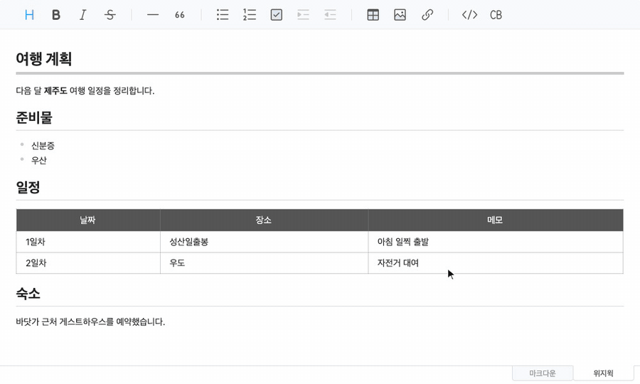
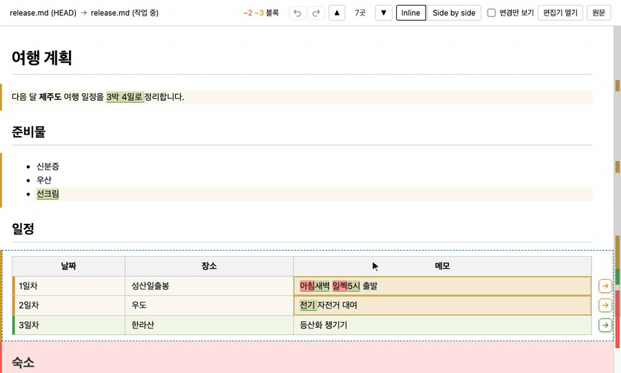
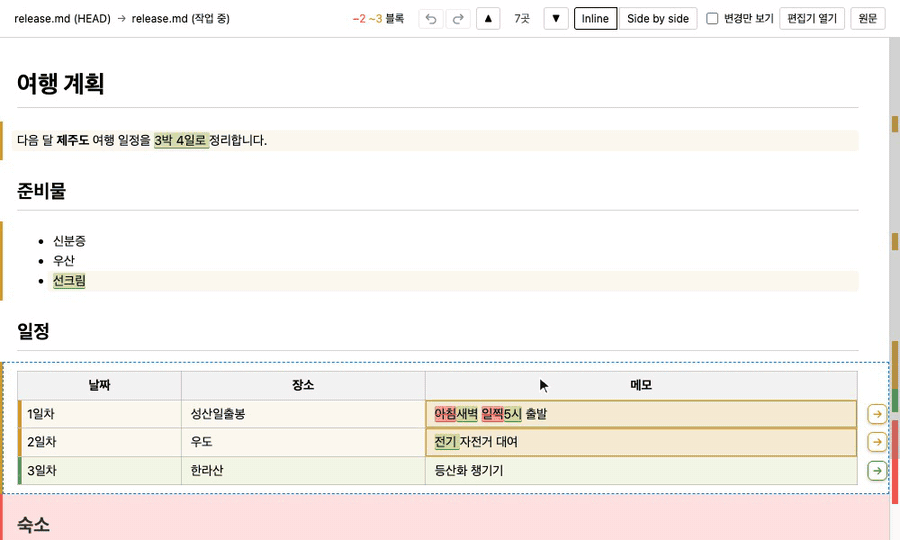

# Markdown Preview Editor & Diff

Markdown 을 **미리보기 화면에서 바로 편집**하고, 바뀐 내용을 **렌더링된 모습 그대로 비교(diff)** 하는 VS Code 확장입니다.

Edit Markdown **right in the rendered preview**, and compare changes as a **rendered diff** — not raw text.

[한국어](#한국어) · [English](#english)

### 미리보기에서 바로 편집 · Edit in the preview

### 렌더링된 Diff · Rendered diff

### Diff 화면에서 바로 고치기 · Fix things right in the diff

---

## 한국어

### 1. 편집 가능한 미리보기

- `.md` 파일을 열고 에디터 우측 상단 `편집 가능한 미리보기로 열기` 아이콘 클릭
  (또는 탐색기 우클릭 → **편집 가능한 미리보기로 열기**, 명령 팔레트 `MD Preview: 편집 가능한 미리보기로 열기`)
- 미리보기 화면에서 그대로 글을 쓰고 서식(제목, 굵게, 리스트, 표, 코드블록, 링크, 이미지 …)을 바꿀 수 있습니다.
- 하단 탭에서 `마크다운` 모드로 바꾸면 원문 + 미리보기 분할 편집도 가능합니다.
- 실제 파일과 연동되는 VS Code 문서이므로 저장(Ctrl+S), 변경 표시, 텍스트 에디터와의 실시간 동기화가 그대로 동작합니다.
- **서식 보존**: 미리보기 편집기는 내부적으로 Markdown 을 다시 쓰지만(`*`→`-`, 표 패딩 등),
  이 확장은 실제로 고친 줄만 원본에 반영하므로 git diff 가 깔끔하게 유지됩니다.
  (안전하게 반영할 수 없는 경우에만 정리된 전체 문서로 저장합니다.)
- **표 열 폭**: 셀 글자 양에 맞춰 열 폭을 자동으로 맞추고, 열 경계를 드래그해 직접 조절할 수 있습니다(더블클릭하면 자동 폭으로).
- 항상 이 에디터로 열고 싶다면: 파일 탭 우클릭 → `Reopen Editor With...` → `Configure default editor for '*.md'`

### 2. 미리보기 Diff

렌더링된 Markdown 을 블록 단위로 맞춰 보고, 바뀐 부분은 단어·표 셀 단위로 강조합니다.

| 여는 방법 | 비교 대상 |
| --- | --- |
| 편집 가능한 미리보기 상단 `HEAD와 비교` 아이콘 / 탐색기 우클릭 | 작업 중인 내용 ↔ Git HEAD |
| `MD Preview: 미리보기 Diff: Git 리비전과 비교...` | 작업 중인 내용 ↔ 선택한 커밋/브랜치 |
| `MD Preview: 미리보기 Diff: 다른 파일과 비교...` | 두 파일 |
| 탐색기에서 `.md` 두 개 선택 후 우클릭 → `선택한 두 파일 비교` | 두 파일 |
| Source Control 등에서 연 **diff 에디터** 우측 상단 아이콘 | diff 에디터의 원본 ↔ 수정본 |

- `Inline` / `Side by side` 보기 전환, `변경만 보기`, 이전/다음 변경 이동(F7 / Shift+F7)
- 표는 행 단위로 맞추고, 바뀐 셀만 강조합니다. `Side by side` 에서는 좌우 표의 열 폭·행 높이·가로 스크롤이 함께 움직입니다.
- 비교 중인 파일을 편집하면 diff 가 실시간으로 갱신됩니다.

#### Diff 화면에서 바로 편집

수정본이 로컬 파일이면(HEAD 비교, 파일 비교, Source Control diff) diff 화면에서 바로 고칠 수 있습니다.

| 동작 | 방법 |
| --- | --- |
| 블록 편집 | 고칠 곳을 **더블클릭** → 바로 입력. 바깥 클릭 또는 Ctrl+Enter 로 적용, Esc 로 취소 |
| 되돌리기 | 블록 옆 화살표: 바뀐 블록은 원래대로, 추가된 블록은 제거, 삭제된 블록은 복원. 표는 행마다 화살표가 있습니다 |
| 실행취소 / 다시실행 | Ctrl+Z / Ctrl+Shift+Z(또는 Ctrl+Y), 상단 버튼 |
| 저장 | 상단 `● 저장 안 됨` 옆 `저장` 버튼 또는 Ctrl+S |
| 문서 전체 편집 | 상단 `편집기 열기` → 편집 가능한 미리보기가 옆에 열리고, 고치는 대로 diff 가 갱신됩니다 |

- 블록 편집도 실제로 바꾼 부분만 원본에 반영합니다.
- 저장하지 않은 채 diff 창을 닫으면 저장 여부를 묻습니다.
- 한 번 클릭하거나 끌어서 글자를 고르면 편집이 열리지 않으므로 복사할 수 있습니다.
- 서식은 단축키(Ctrl+B, Ctrl+I 등)로, 표 행·열 추가는 표 위 우클릭 메뉴로 합니다.

### 설치

- **VS Code**: 확장 뷰에서 `Markdown Preview Editor & Diff` 검색
- **Cursor / Kiro / Windsurf / VSCodium**: 확장 뷰에서 `vuei91` 검색 ([Open VSX](https://open-vsx.org/extension/vuei91/md-preview-editor))
- **직접 설치**: [Releases](https://github.com/vuei91/md-preview-editor/releases)에서 `.vsix` 를 받아 확장 뷰 `...` 메뉴 → `Install from VSIX...`

### 설정

| 설정 | 기본값 | 설명 |
| --- | --- | --- |
| `mdPreviewEditor.editMode` | `wysiwyg` | 편집 가능한 미리보기를 열 때의 기본 모드 (`wysiwyg` / `markdown`) |
| `mdPreviewEditor.diff.defaultView` | `inline` | Diff 기본 보기 (`inline` / `sideBySide`) |

### 알려진 제약

- 미리보기 편집기([Toast UI Editor](https://github.com/nhn/tui.editor), CommonMark + GFM)가 지원하지 않는 문법
  (front matter, 수식, mermaid 등)은 편집 시 일반 텍스트/코드로 취급될 수 있습니다.
- Diff 는 최상위 블록(문단, 리스트, 표 …) 단위로 맞춥니다. 표의 열이 추가·삭제되면 좌우 열 폭은 맞추지 않습니다.

---

## English

### 1. Editable preview

- Open a `.md` file and click the **Open as editable preview** icon at the top right of the editor
  (or right-click the file in the Explorer, or run `MD Preview: 편집 가능한 미리보기로 열기` from the Command Palette).
- Type and format (headings, bold, lists, tables, code blocks, links, images …) directly in the rendered view.
- Switch to the `Markdown` tab at the bottom for a side-by-side source + preview editor.
- It edits the real VS Code document, so saving (Ctrl+S), the dirty indicator, and live sync with the text editor all just work.
- **Keeps your formatting**: the preview editor re-serializes Markdown internally (`*`→`-`, table padding, …),
  but only the lines you actually changed are written back, so your git diffs stay clean.
- **Table column widths** fit the content automatically; drag a column border to resize (double-click to reset).
- To always open `.md` files with it: right-click the file tab → `Reopen Editor With...` → `Configure default editor for '*.md'`.

### 2. Rendered diff

Blocks of rendered Markdown are aligned, and changes are highlighted down to the word and table cell.

| How to open | Compares |
| --- | --- |
| `HEAD와 비교` (Compare with HEAD) icon in the editable preview / Explorer context menu | Working copy ↔ Git HEAD |
| `MD Preview: 미리보기 Diff: Git 리비전과 비교...` | Working copy ↔ a commit/branch you pick |
| `MD Preview: 미리보기 Diff: 다른 파일과 비교...` | Two files |
| Select two `.md` files in the Explorer → right-click → `선택한 두 파일 비교` | Two files |
| Icon at the top right of a **diff editor** (e.g. from Source Control) | Original ↔ modified |

- Switch between `Inline` and `Side by side`, show changes only, jump between changes (F7 / Shift+F7).
- Tables are compared row by row with changed cells highlighted; in `Side by side`, column widths, row heights and horizontal scrolling stay in sync.
- The diff updates live as you edit the file.

#### Edit right in the diff

When the modified side is a local file (HEAD, file-to-file, Source Control diffs), you can fix things directly in the diff.

| Action | How |
| --- | --- |
| Edit a block | **Double-click** where you want to type. Click outside or press Ctrl+Enter to apply, Esc to cancel |
| Revert | Arrow next to a block: modified → original, added → removed, removed → restored. Tables have an arrow per row |
| Undo / Redo | Ctrl+Z / Ctrl+Shift+Z (or Ctrl+Y), or the toolbar buttons |
| Save | `저장` (Save) button next to `● 저장 안 됨` (Unsaved), or Ctrl+S |
| Edit the whole document | `편집기 열기` (Open editor) opens the editable preview beside the diff |

### Install

- **VS Code**: search for `Markdown Preview Editor & Diff` in the Extensions view
- **Cursor / Kiro / Windsurf / VSCodium**: search for `vuei91` ([Open VSX](https://open-vsx.org/extension/vuei91/md-preview-editor))
- **Manual**: download the `.vsix` from [Releases](https://github.com/vuei91/md-preview-editor/releases) → Extensions view `...` → `Install from VSIX...`

### Settings

| Setting | Default | Description |
| --- | --- | --- |
| `mdPreviewEditor.editMode` | `wysiwyg` | Default mode when opening the editable preview (`wysiwyg` / `markdown`) |
| `mdPreviewEditor.diff.defaultView` | `inline` | Default diff view (`inline` / `sideBySide`) |

### Known limitations

- Syntax the preview editor ([Toast UI Editor](https://github.com/nhn/tui.editor), CommonMark + GFM) doesn't support
  (front matter, math, mermaid, …) may be treated as plain text or code while editing.
- The diff aligns top-level blocks (paragraphs, lists, tables, …). Column widths aren't matched when table columns are added or removed.
- The UI is currently in Korean.

---

개발 · 배포 · 코드 구조 / Development: [DEVELOPMENT.md](DEVELOPMENT.md)
